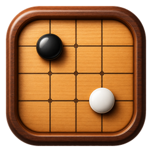
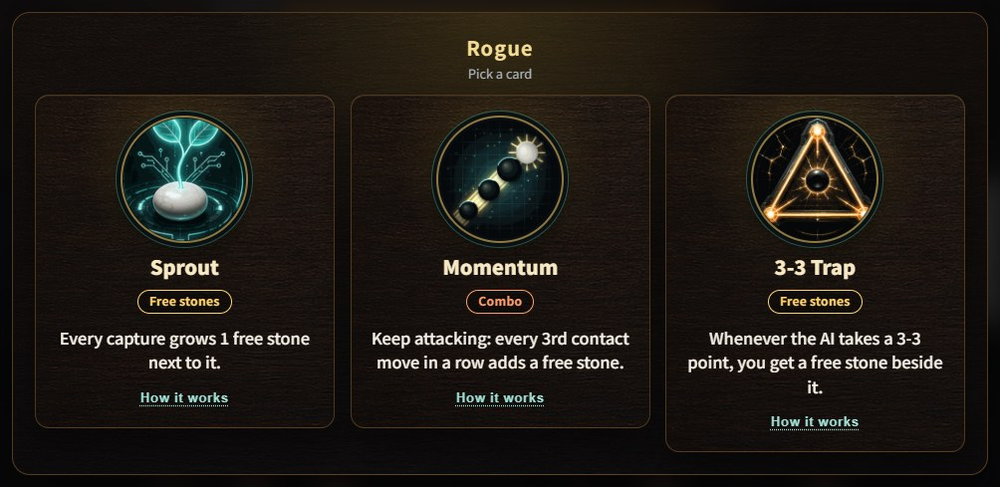
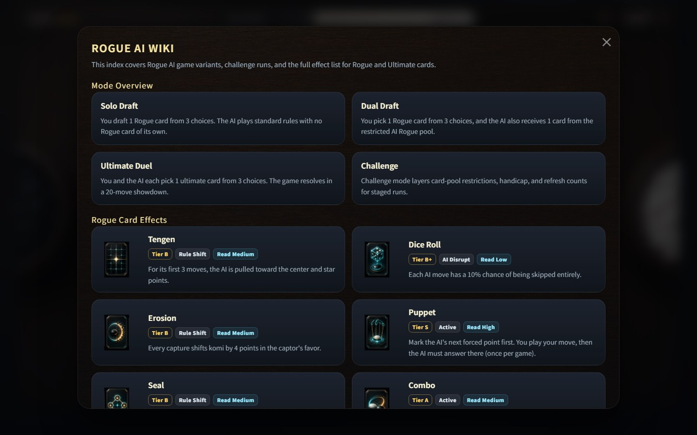
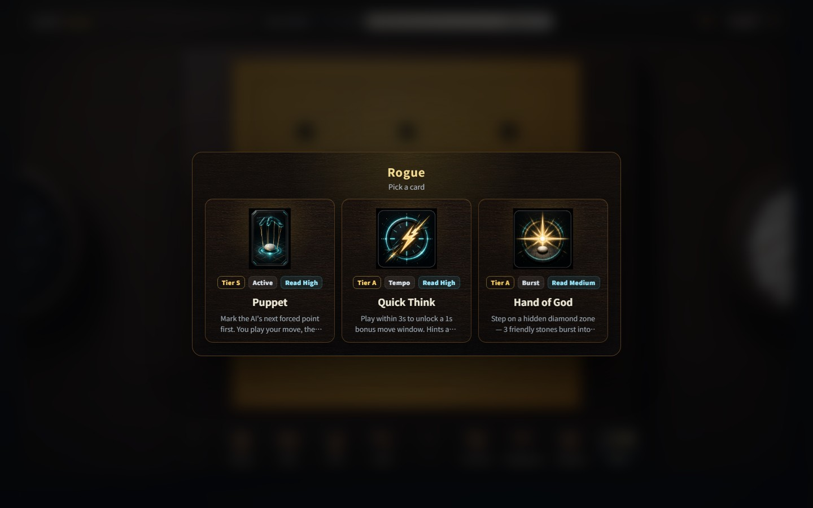

  

<h1 align="center">rogue-go-arena</h1>

  Real Go against KataGo, with roguelike cards that shake up every game. 
  <a href="https://github.com/gongyu0918-debug/rogue-go-arena/releases/latest"><strong>Download for Windows</strong></a>
  ·
  <a href="docs/README.zh-CN.md">简体中文</a>
  ·
  <a href="docs/README.ja.md">日本語</a>
  ·
  <a href="docs/README.ko.md">한국어</a>

  

## What is this?

rogue-go-arena is a Go game for Windows. You play real Go on a real board
against KataGo, one of the strongest Go engines around.

Before the game starts, you pick a card. Cards bend the rules a little. One
might grow a free stone every time you capture. Another might force the AI to
play where you choose. No two games feel the same, but it is still Go, and
good moves still win.

If you are new to Go, this is a friendly way in. If you already play, it is a
fresh way to play against a strong engine.

## Download and play

1. Open the [latest release](https://github.com/gongyu0918-debug/rogue-go-arena/releases/latest).
2. Download `rogue-go-arena_WebView_Setup_<version>.exe`.
3. Run it. It installs for your user only, so you don't need admin rights.
4. Start rogue-go-arena from the desktop or the Start menu.

You need Windows 10 or 11 (64-bit). A graphics card helps but is not
required: the game uses your GPU when it can and falls back to the CPU.

The installer picks its language from your Windows settings. The game itself
speaks English, Simplified Chinese, Traditional Chinese, Japanese, Korean,
French and German. You can switch at any time.

## Game modes

Click **Start** and choose a mode.

**Game.** Plain Go against the AI. Pick a difficulty and you get handicap
stones to match. Tick *Advanced* if you'd rather set the AI's rank, the
handicap and komi yourself. You can choose 19×19, 13×13 or 9×9, Chinese or
Japanese rules, and a time control.

**Rogue.** Go with cards, on 19×19.
- *Quick Game:* you pick one card out of three. One game, start to finish.
- *Dual Draft:* you pick a card, and the AI gets one too.

**Challenge.** A run of five games in a row. You play White and pick one more
card before each stage. The AI gets a bigger head start every stage: more
komi, and from stage 3 on it starts with handicap stones.

**Study.** Watch the AI play itself. Good for learning openings and shape.

**Two Players.** Two people share one board on the same computer.

## The cards

At the start of a Rogue game you see three cards and keep one. Each card says
in one line what it does. Tap *How it works* for the full rules.

  

Up to 28 different cards can show up in the draft. Some examples:

| Card | What it does |
| --- | --- |
| Sprout | Every capture grows a free stone next to it. |
| 3-3 Trap | Whenever the AI takes a 3-3 point, you get a free stone beside it. |
| Momentum | Keep attacking: every third contact move in a row adds a free stone. |
| Capture Chain | Capture on back-to-back turns for bonus stones. |
| Puppet | Once per game, pick a point and the AI must play there next. |
| Combo | Once per game, play two moves in a row. |
| Dice Roll | Each AI move has a small chance to turn into a pass. |
| No Regrets | No undo, but after each AI move you sometimes get a free stone. |
| Hand of God | Find the hidden spot to get three free stones around it. |
| Last Stand | Once, if your win rate drops below 26%, removes an enemy stone near the last move and adds one of yours. |

Each card shows a small tag so you know what kind it is: free stones, combo,
active skill, hinders the AI, tempo, or komi.

Cards can also level up. A card that triggers often enough grows to Lv 2 and
Lv 3 and gives a little extra each time. When a card changes the board, the
game shows how much it moved your win rate.

**Fair play.** Strong cards are fun, but they would make every game a
walkover. So the AI gets some komi back based on how strong your cards are.
The top bar shows your **target**: how far ahead the AI starts. It also shows
how far ahead you are right now. Beat the target and you win.

## Screenshots

| The in-game guide | Picking a card |
| --- | --- |
|  |  |

## FAQ

**Is this real Go?**
Yes. Captures, ko and scoring all work as usual, and KataGo counts the score
at the end. Cards add, move or remove a few stones and adjust komi, but the
game underneath is plain Go.

**Which difficulty should I pick?**
Start with *Beginner* or *Easy*. The AI always plays at the same strength
(unless you pick a rank under *Advanced*), and the difficulty decides how much
help you get. In Game mode that means handicap
stones; with cards it means komi. Move up when you start winning easily.

**Do I need a strong graphics card?**
No. A GPU makes the AI think faster, but the game also runs on the CPU. The
first start can take a little longer while the engine gets ready.

**Can I change the cards?**
Yes. Open **Settings** and choose **Card Editor**. You can turn cards on or
off and tweak their numbers. Changes apply from your next game.

**Where are my settings, and how do I uninstall?**
Your saved card settings and engine data live in
`%LOCALAPPDATA%\rogue-go-arena`. Uninstall from Windows *Settings → Apps*. The
uninstaller asks whether to remove your saved data too.

**Windows warns me about the installer.**
The installer isn't code-signed, so Windows SmartScreen may show a warning.
Choose *More info* and then *Run anyway* if you downloaded it from the
releases page above.

**Is there a Mac or Linux version?**
Not right now. The game is built and tested for Windows.

**Can I save my games?**
Yes. The *Review / SGF* panel can save and load SGF files and step through a
game move by move.

## Credits and license

rogue-go-arena is open source under the [MIT License](LICENSE).

It is built on [KataGo](https://github.com/lightvector/KataGo) by David J Wu
(lightvector) and contributors, with networks from
[katagotraining.org](https://katagotraining.org/). It is not an official
KataGo project. Third-party licenses are listed in
[THIRD_PARTY_NOTICES.md](THIRD_PARTY_NOTICES.md).

Want to build it yourself or help out? See the [development notes](docs/development.md).
