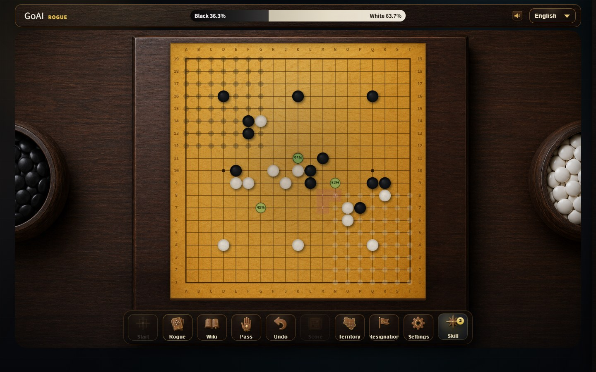

# rogue-go-arena（简体中文）

[English](../README.md) · [日本語](README.ja.md) · [한국어](README.ko.md)

  

rogue-go-arena 是一款 Windows 围棋游戏。你在真正的棋盘上，和当今最强的围棋引擎之一 KataGo 对弈。

开局前你会挑一张卡牌。卡牌会稍微改写规则：有的让你每次提子都长出一颗棋子，有的能指定 AI 下在哪里。每一局都不一样，但这仍然是围棋，好棋依然能赢。

## 下载与开始

1. 打开 [最新版本](https://github.com/gongyu0918-debug/rogue-go-arena/releases/latest)。
2. 下载 `rogue-go-arena_WebView_Setup_<版本号>.exe` 并运行。安装只针对当前用户，不需要管理员权限。
3. 从桌面或开始菜单启动。

需要 Windows 10 或 11（64 位）。有显卡会更快，没有也能用 CPU 运行。游戏支持简体中文、繁體中文、English、日本語、한국어、Français、Deutsch。

## 玩法

- **对局**：普通的人机围棋。选择难度后会给你相应的让子；勾选“高级”可自己设置等级、让子和贴目。
- **Rogue**：19 路带卡对局。“快速对局”只有你带卡；“双人抽卡”AI 也会拿一张。
- **闯关**：连续五关，你执白，每关多选一张卡。AI 的贴目逐关增加，第 3 关起开局就有让子。
- **学习**：观看 AI 自战。
- **双人**：两个人在同一台电脑上对弈。

卡牌每张都有一句话说明，点“玩法说明”可看完整规则。卡牌越强，AI 得到的贴目越多；顶部会显示“目标”（AI 的先手优势）和你当前的领先，超过目标就能赢。

## 常见问题

- **难度怎么选？** 先从“入门”或“简单”开始。AI 强度固定，难度决定你得到多少帮助。
- **能改卡牌吗？** 可以。在“设置”里打开“卡牌编辑器”，下一局生效。
- **Windows 提示安装包有风险？** 安装包没有代码签名，可能出现 SmartScreen 提示；确认是从上面的发布页下载后，点“更多信息”再点“仍要运行”。

更多内容请看 [英文说明](../README.md)。本项目以 [MIT 许可证](../LICENSE) 开源，基于 [KataGo](https://github.com/lightvector/KataGo) 构建，但不是 KataGo 官方项目。
